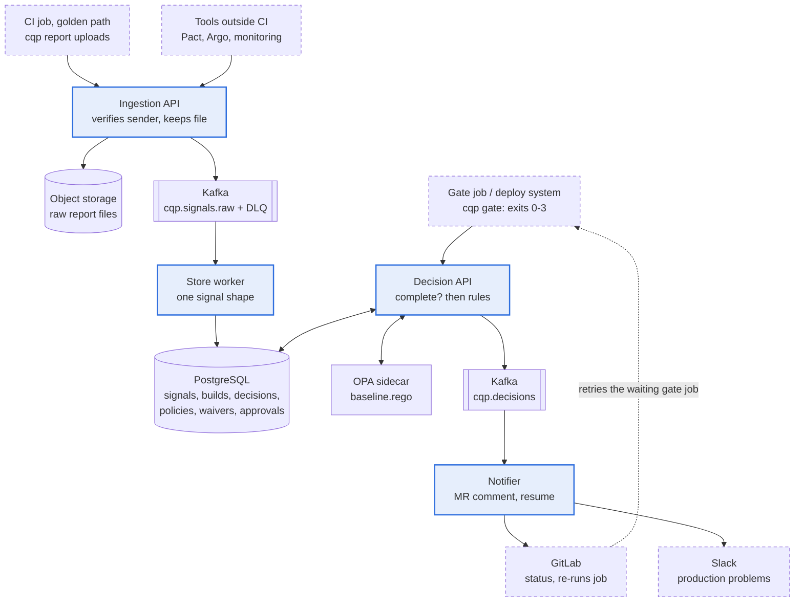

# Continuous Quality Platform: Technical Design

*The same document is kept as a shared doc for review; this copy lives with the code.*

The Continuous Quality Platform (CQP) answers one question at every delivery stage: is there enough evidence to let this change move on? It reads the results teams' tools already produce, judges them against versioned rules, and returns one of four explained outcomes that pipelines act on. A working prototype backs the design.

## 1. Problem and assumptions

The hard part is not running more checks. It is that 50 teams produce thousands of results a day in different shapes, and nothing combines them into a decision anyone can explain. The recurring problems map to design goals:

| Problem in the brief | Design goal |
| --- | --- |
| Signals look different per tool | One normalised signal model; tools keep their formats |
| Gates vary; central wants consistency | An organisation baseline that teams may tighten, never loosen where locked |
| Unclear why a build is blocked | Named findings with a rule and a plain message, plus the exact input |
| Slow and long-running checks | Per-check deadlines; pipelines are resumed, not held |
| Flaky tests and blind reruns | A pass that needed a rerun is flagged; quarantine is explicit and bounded |
| Teams blocked by old problems | Before production, findings already on the protected branch only warn |
| The platform must not be a bottleneck | Fail open on unknowns before production, fail to approval at production, never in the rollback path |

**Assumptions**

- GitLab CI with shared templates is the golden path; each job can get a short-lived OIDC token (GitHub Actions works the same way).
- A service catalog owns each service's repo, team and tier (`catalog.yaml` stands in), and lists the third-party providers a service depends on.
- One deploy system ships to production (Argo CD and Argo Rollouts assumed).
- Tools emit JUnit, SARIF, CycloneDX or a JSON summary; tools outside CI can call a signed webhook.
- Event producers register Avro or Protobuf schemas in a schema registry; Postgres migrations live in the service repo; the web app has preview builds per MR.
- Monitoring sends SLO and real-user metrics; the incident tool sends open and resolve events.
- About 500 pipelines and 30–50 production deploys a day, doubling in two years.

## 2. Architecture

CQP is a thin decision layer added to the golden path. Evidence flows in from tools teams already run, is normalised and stored, and is judged only when a pipeline asks. Pipelines stay in control: CQP answers, it never drives a pipeline.

Blue: CQP deployable · dashed: existing system · plain: infrastructure.

Results enter through one Ingestion API, Kafka buffers them, the store worker writes normalised signals to Postgres, and the Decision API judges them (with OPA) when a gate asks. The notifier turns each decision into feedback and resumes waiting gate jobs.

**How CQP connects to existing systems**

| System | How CQP uses it (never replaces it) |
| --- | --- |
| Golden path | Adds `.quality-report`, `.quality-gate` and the `quality-policy` job; onboarding is "extend the template" |
| Source control | OIDC tokens prove repo, commit, job and protected ref; team policy lives in the repo; MR comments and commit statuses |
| CI/CD | Gate exits 0 proceed, 1 blocked, 2 needs a person, 3 still waiting (re-run automatically) |
| Tests, security, static analysis | JUnit, CycloneDX and SARIF files the tools already write; Pact Broker by webhook |
| Event schemas, databases | Schema-registry compatibility answers and squawk migration lint, uploaded by `cqp report` |
| Web app, third parties | Lighthouse CI, real-user monitoring and synthetic checks through the same two paths (design-only) |
| Deployment | The deploy system asks `prod-deploy`; Argo Rollouts reports canaries; CQP is never in the rollback path |
| Observability | SLO burn, incidents and freezes by signed webhook |
| Service catalog | Source of tier, owner, repo and third-party dependencies; CQP keeps no copy |

## 3. Components and responsibilities

CQP is four deployables built from one repository and one image. They are separate processes because their load and failure behaviour differ; they share one repository because the code they share is the contract between them.

| Component | Responsibility | If it is down |
| --- | --- | --- |
| **Ingestion API** | Verify sender and ownership, mark trust, keep the raw file, publish one event | CI keeps reports as artifacts; webhooks retry |
| **Store worker** | Normalise each event, write it idempotently, dead-letter what can't be read | Evidence queues in Kafka |
| **Decision API** | Completeness, rules in OPA, record the decision with its input; approvals, previews, backtests | Gates fall back (section 10) |
| **Notifier** | MR comment, commit status, Slack, resume waiting gate jobs, waiver reminders | Feedback lags; decisions don't |

Kafka, PostgreSQL, object storage, OPA and Prometheus are off the shelf.

## 4. Quality signal model

Every result, whatever tool produced it, becomes one **signal**: a small, typed fact about one check on one change. Tools keep their native formats; CQP does the conversion once, in the store worker.

**Signal fields**

| Field | Meaning |
| --- | --- |
| `event_id` | Hash of producer, check, service, commit, run and file contents; duplicates collapse |
| `service`, `commit`, `image` | What the result is about |
| `check`, `kind` | e.g. `tests.unit`, `scan.sca`, `perf.load`; kind is `outcome`, `findings`, `measurement` or `health` |
| `status`, `payload` | `pass` or `fail`, plus counts and identifiers (failing tests, CVE IDs), never percentages |
| `run`, `observed_at` | Which run, and when it produced the result; the newest run wins, whatever arrives last |
| `trusted` | From a protected branch or a signed webhook |

**How the brief's examples are represented**

| Example in the brief | Stored as | How the rules read it |
| --- | --- | --- |
| 96% tests passed | `outcome` with counts and failing test names | Fail with the stage's effect; *which* tests failed is known |
| Contract validation failed | `tests.contract` fail, from Pact Broker | Block from build on (locked) |
| Critical vulnerability | `findings` with CVE IDs | Block from build; only warns before production if already on the protected branch |
| P95 latency up 20% | `measurement`, p95 in ms | Warns above +20% over the protected branch; teams set their own limit |
| Deployment error rate up | `deploy.canary` fail, from Argo Rollouts | Rollout already rolled back; next deploy warns |
| End-to-end test failed | `tests.e2e` fail | Warn at PR, validate at integration |
| Static-analysis threshold exceeded | `findings` with fingerprints | Warn at PR, block at build; new vs existing by fingerprint |

**Ingestion.** CI jobs upload with `cqp report` and their OIDC token; repo, commit and job come from the token, never the request. Tools outside CI post signed webhooks. A file that can't be parsed is dead-lettered and counts as missing, never as a pass.

**Correlation.** Signals join on service plus change: the commit before a build, then the image, which a `build.provenance` signal links to its commit. Production state joins at `prod-deploy`. Each decision also sees reruns of the same change and the protected branch's last result per check, to flag flaky passes and tell new findings from old.

**Trust.** Any branch can run a job that claims to be about any image. So only a trusted build links an image to its commit, and at `prod-deploy` an untrusted result can only make things stricter. Signed SLSA provenance (Sigstore) is the production path.

**Beyond backend CI.** The brief's platform also has a web app, event-driven services, databases and third-party integrations. Each fits the same model: a new check name, one parser or webhook adapter, and one baseline rule. Event schemas and migrations are built in the prototype; the web-app and third-party signals are design-only.

| Part of the platform | Signal and source | Baseline effect | Status |
| --- | --- | --- | --- |
| Event-driven services | `contract.schema`: the schema registry's compatibility answer per subject (Avro or Protobuf) | Incompatible subject blocks from build on, named in the finding; locked | Built (message pacts: design-only) |
| Databases | `db.migration`: squawk lint of the migration diff | Destructive step (drop, rename, type change) blocks at build and prod-deploy; long-lock step needs validation | Built |
| Web app (SPA) | `web.budget`: Lighthouse CI on the MR's preview build | Warn above +20% over the protected branch; teams set hard budgets | Design-only |
| Web app in production | `runtime.rum`: p75 LCP and INP per release | A regressed release warns the next deploy; tier-1 needs approval | Design-only |
| Third-party integrations | `dep.health`: synthetics and provider status for providers the catalog lists | Degraded provider warns `prod-deploy`; never blocks a fix | Design-only |

All of them arrive through paths that already exist: `cqp report` in the golden-path job for Lighthouse and migration lint, signed webhooks for the schema registry, real-user monitoring and synthetics. No new component is needed.

**API surface**

| Endpoint | Caller | Purpose |
| --- | --- | --- |
| `POST /v1/reports`, `/v1/hooks/{tool}` | CI jobs, tools | Evidence in |
| `POST /v1/decisions` | Gate job, deploy system | Outcome, findings, what it waits for |
| `POST /v1/decisions/{id}/approvals` | An approver, not the requester | Accept the `validate` findings, 24 h |
| `POST /v1/preview` | Developer, no token | Local results under the real rules |
| `PUT /v1/team-policies/{service}` | `quality-policy` job | Validate, backtest, publish |

## 5. Quality decisions and policy

A decision is the strictest of a set of named findings. There is no score: a score hides which check mattered and invites arguments about weights.

| Outcome | Produced when | Pipeline effect |
| --- | --- | --- |
| `PROCEED` | No findings | Exit 0, status green |
| `PROCEED_WITH_WARNING` | Strictest finding is `warn` | Exit 0; findings shown in the MR and job log |
| `REQUIRE_VALIDATION` | Strictest finding is `validate` | Exit 2; an approver who isn't the author runs `cqp approve`, then the gate is re-run |
| `REQUIRE_VALIDATION`, status `pending` | Evidence is still on its way, before its deadline | Exit 3; the runner is freed and the notifier re-runs the job when the evidence lands |
| `BLOCKED` | Any finding is `block` | Exit 1, status red |

**How a decision is made**

1. **Expected evidence.** `expectations.yaml` lists the checks each stage waits for, per tier, each with a deadline and an `on_missing` effect.
1. **Completeness.** A check not yet reported is *waiting* until its deadline, then *missing*. The caller's own uploads are waited for during that gate job's first minute.
1. **Never decide on half the evidence.** While anything waits, the answer is `pending`, listing what it waits for.
1. **Rules.** OPA evaluates `baseline.rego`: failing checks get the stage's effect, missing ones their `on_missing`, production state adds its own findings. Old findings on the protected branch only warn before production; a pass that needed a rerun warns.
1. **Overrides,** in order: kill switch, waiver, quarantine, approval, break-glass. Each turns findings into warnings; none hides them.
1. **Record.** Insert-only, with the exact input, both policy versions and who asked, so any decision can be replayed.

**Policy layers**

| Layer | Owned by | Lives in | Can |
| --- | --- | --- | --- |
| Organisation baseline | Central quality and security | `policy/baseline.rego`, `expectations.yaml` in a central repo | Set stage effects for every check; lock cells such as security scans and production tests |
| Team policy | Each team | `.quality/policy.yaml` in the service repo | Wait for extra checks, make effects stricter, add thresholds (p95 under 150 ms, or at most 10% worse than the protected branch), quarantine up to 10 flaky tests per check under a ticket; never loosen a locked cell |
| Waiver | Approver for the service, security for security rules | API or portal | Accept named findings (for example one CVE) for at most 30 days |
| Approval | Approver for the service who didn't start the job | `cqp approve` or portal | Accept exactly the `validate` findings of one final decision, for 24 hours |

**Lifecycle of a policy change**

- **Review** in a merge request. A team policy is checked against the baseline's bounds and **backtested** on the last 40 decisions (*1 of 40 would change: integration PROCEED → BLOCKED*); a baseline change is backtested on the last 200 across all services.
- **Publish** from a protected branch of the owning repo only; **version** by content hash; **replay** any decision on the rules it was made with.

**Overrides**

|  | Waiver | Kill switch | Break-glass |
| --- | --- | --- | --- |
| For | A known, accepted finding | A rule that is wrong everywhere | An emergency change |
| Scope | One rule (and named items) on one service | One rule, all services | One change at one stage |
| Who | Approvers; security for security rules | Platform team | On-call, approvers, security |
| Lasts | Up to 30 days | Up to 72 hours | 24 hours |
| Always | Shown on the finding with its ticket; reminder 2 days before expiry | Logged, metric and alert after 4 hours | Slack announcement and a ticket for review |

## 6. Important system flows

Three flows carry most of the design.

**A. Merge request: a failing unit test**

1. The test job runs the team's own command; `cqp report` uploads the JUnit file with the job's token.
1. The Ingestion API verifies the token and ownership, keeps the file and publishes an event; the store worker writes a `tests.unit` fail signal naming the test.
1. The gate job asks; if its own uploads aren't stored yet, it gets `pending` and polls.
1. OPA returns `baseline.tests.unit` with effect `block`. The gate exits 1; the notifier updates the one CQP comment on the MR and sets `cqp/pr` to failed.

**B. A check that takes hours**

1. The integration gate asks while `perf.load` (deadline 120 min) has not reported. The answer is `pending`, listing `perf.load` and its deadline.
1. After at most `--max-wait` (120 s by default) the gate exits 3 and frees the runner; the job log and MR comment say it will re-run by itself. The notifier records the waiting job.
1. Every 10 s the notifier checks stored evidence. When `perf.load` arrives, or the deadline passes, it asks GitLab to retry that gate job.
1. The retried job asks again and gets a final decision. CQP never drives the pipeline; GitLab re-runs its own job.

**C. Production deploy**

1. The deploy system, not the service pipeline, asks for `prod-deploy` about the image it will deploy. Only projects in `trust.yaml`, from a protected branch, may ask.
1. Evidence is gathered for the image and the commit its trusted build came from; an untrusted result about the image can only make things stricter. Production state (error budget, open incidents, recent canary failures, change freeze, health freshness) is added to the input.
1. On `PROCEED`, Argo Rollouts runs the canary with its own analysis and rolls back by itself on failure. The analysis result comes back as a `deploy.canary` signal and shapes the next decision.
1. On `REQUIRE_VALIDATION`, an approver of the service who didn't start the deploy accepts it with `cqp approve` and the gate is re-run; on `BLOCKED` it stops. A non-clean production decision is posted to Slack.

## 7. Production quality

Production signals do two jobs: they verify the deploy that just happened, and they shape the next one. CQP is deliberately not in the rollback path: the rollout controller already has the data and acts in seconds, and a central service there would add a failure point at the worst moment.

| Signal | Sent by | Effect on the next `prod-deploy` decision | Rule |
| --- | --- | --- | --- |
| Error budget used up | Monitoring (SLO burn updates) | Needs approval, unless released as a fix with a ticket | `baseline.error_budget` |
| An incident open | Incident tool (open and resolve, tracked per incident) | Needs approval, unless released as a fix | `baseline.active_incident` |
| Released as a fix | The deploy request (`--fix INC-77`) | Warning, so the exception is visible in Slack | `baseline.fix_release` |
| A canary failed in the last 24 h | Argo Rollouts analysis | Warning: use the slowest rollout steps | `baseline.recent_rollback` |
| Organisation-wide change freeze | Release management | Blocked; only break-glass passes | `baseline.change_freeze` |
| Health data missing or older than 5 min | Absence of SLO updates | Approval for tier-1, warning for others | `baseline.production_health` |

Real-user metrics and third-party health would shape the next deploy the same way (section 4, design-only).

The production state a decision read is stored in its input, so a replay sees the same thing. Missing health data counts as stale, never as healthy.

## 8. Developer experience

The aim is that a developer learns *why* without leaving the merge request, and never has to change how they write tests. Items marked *proposed* are designed but not in the prototype.

| Moment | What the engineer sees or does |
| --- | --- |
| **Merge request** | One CQP comment, updated in place: outcome, each finding with its rule ("tests.unit failed: PaymentRefundTest.partial"), what it waits for, what happens next. One status per stage. |
| **Pipeline log** | Same findings; exit 0, 1, 2 or 3; `cqp explain <id>` unless it's a clean proceed. A refused request fails loudly with the reason. |
| **Before pushing** | `cqp preview` judges local reports under the real rules, needs no token and records nothing; works as a pre-push hook. |
| **Investigating** | `cqp explain <id>` gives each finding a next step: fix, rerun, waiver, approval or quarantine. |
| **Flaky tests** | A pass that needed a rerun is flagged by name; the portal lists candidates; the team quarantines up to 10 per check under a ticket. |
| **Onboarding** | Catalog entry with `mode: shadow`, `extends: .quality-report` on jobs that already write reports, one gate per stage. No test changes. |
| **Changing policy** | Edit `.quality/policy.yaml` in an MR; the check shows which recent decisions would change. |
| **Getting unblocked** | Fix; or an approver who isn't the author runs `cqp approve`; or a waiver naming the items; or break-glass in an emergency. All audited. |

It builds confidence rather than gates: no guessing why something is red, no runners held for long checks, no blocks for debt a change didn't add.

## 9. Incremental adoption

CQP arrives through the golden path one service at a time, and each service moves through three modes with a one-line catalog change. The outcome is computed the same way in every mode, so the decisions table always shows what enforcement *would* have done.

| Mode | Decision recorded | Gate | Developers see | Move on when |
| --- | --- | --- | --- | --- |
| `shadow` | Yes | Exits 0 at once, never waits | Nothing | Evidence arrives for every expected check, and the would-block rate is understood |
| `advisory` | Yes | Exits 0; log says "would be BLOCKED" | MR comment marked advisory; status stays green | Would-block rate is low and every block was a real problem |
| `enforce` | Yes | Acts on the outcome | Everything | — |

**Rollout order**

1. **Reporting only.** Add `.quality-report` to the golden-path templates. Uploads never fail a job, so this is safe to turn on for every team. Evidence starts to flow.
1. **Shadow decisions** for all catalogued services. Tune `expectations.yaml` and the baseline against real data before anyone sees an outcome.
1. **Advisory** per team, starting with volunteers and tier-1 services. Teams publish their own policy files.
1. **Enforce at PR and build** first, where a false block costs minutes. **Enforce at ****prod-deploy** last, once the deploy system's approval step is wired in.

Each move is gated by data, not a date: the team's would-block rate and the share of those blocks the team agrees were real.

## 10. Scale and reliability

Load is not the problem: about 5,000 evidence events a day today and 10,000 at twice the size, well under one a second even at a tenfold peak. The risks are decision-path availability, notification correctness and people's attention, so the effort goes into correctness under failure.

| Concern | How it is handled |
| --- | --- |
| **Parallelism** | Stateless APIs; store workers scale with Kafka partitions keyed by `service:commit` |
| **Duplicates** | Hashed `event_id`, idempotent insert |
| **Out of order** | Newest by when the result was produced, not when it arrived |
| **Delayed and long checks** | Deadlines and `pending`; the gate exits 3 and the notifier re-runs it |
| **Partial failures** | Offsets committed after the write; unreadable events dead-lettered as missing |
| **CQP outage** | Uploads never fail a job. The gate stops on this pipeline's own failed unit, component or integration tests or secrets scan, otherwise warns before production and needs approval at `prod-deploy` |
| **Bad rule release** | Backtested on its MR; a too-many-blocks alert and a kill switch if one slips through |

**Consistency**

| Strong consistency (one Postgres transaction) | Eventual consistency is fine |
| --- | --- |
| A decision and the evidence snapshot it read | Evidence ingestion (seconds behind; covered by `pending`) |
| The decision record and its policy versions | MR comments, commit statuses, Slack |
| Publishing a team policy; creating or revoking a waiver, approval, kill switch or break-glass | Resuming waiting gate jobs (10 s sweep) |
| Insert-only decision history | Metrics and dashboards |

The rule of thumb: anything a production decision or an audit depends on is written transactionally and never updated; anything that only informs people may lag.

## 11. Operations and observability

CQP is operated as a tier-1 internal service, because a wrong or missing answer at `prod-deploy` costs either an outage or a stuck release.

**SLOs**

| SLO | Target | Measured by |
| --- | --- | --- |
| Decision latency | p99 under 1 s | `cqp_decision_seconds` |
| Decision availability | 99.9% of requests succeed | `cqp_decision_errors_total` |
| Evidence freshness | 99% stored within 60 s of upload | `cqp_evidence_delay_seconds` |

**Alerting.** SLO breaches page; drift tickets: dead-lettered events, too many blocks after a release, a rule switched off over 4 hours, any break-glass. Rules are tested with `promtool`.

**Auditing.** Decisions and every override are insert-only, with who, why and a ticket; any decision can be replayed on its own rules.

**Failure investigation.** A decision ID appears in the job log, the MR comment and Slack; `cqp explain <id>` lists each finding with its next step, `GET /v1/decisions/{id}` (with a token) returns the input and findings, and the raw report is one hop away. *Proposed:* trace IDs from upload to decision across the four deployables.

**D****isaster recovery.** Postgres with point-in-time recovery and a cross-region replica (RPO minutes); signals can be rebuilt from raw files; policy redeploys from Git. During an outage the gate fallbacks keep delivery moving.

**Capacity****.** Review quarterly: evidence per day, peak decision requests, table growth and consumer lag; partition tables by month before any passes about 100 million rows.

## 12. Build vs buy

Build only the thin layer that is specific to this organisation: the signal model, the decision service and the golden-path glue. Everything generic is adopted or delegated.

| Capability | Decision | Choice |
| --- | --- | --- |
| Signal model, decision service, team-policy bounds, overrides, golden-path glue | **Build** | Small Python services (prototype) |
| Rules, messaging, storage, metrics | **Open source** (managed where possible) | OPA, Kafka, PostgreSQL, S3, Prometheus |
| Provenance, vulnerability lifecycle, catalog | **Open source** | Sigstore/SLSA, Dependency-Track, Backstage |
| Flaky-test analytics | **Consider buying** | e.g. Datadog CI Visibility, BuildPulse |
| Scanners and observability | **Keep existing** | e.g. SonarQube, Snyk, Trivy, Datadog |
| Tests, canaries and rollback, contracts, CI and identity | **Delegate** | Team frameworks, Argo Rollouts, Pact Broker, GitLab |

**The most important calls**

- **Build the decision layer, not a dashboard.** Products aggregate results; none gives a versioned, explainable decision with team policy inside central bounds.
- **Adopt OPA** rather than write a rule engine: reviewable, testable, and it also checks team policies and overrides.
- **Standard formats** cover most tools without an integration per tool.

## 13. Key trade-offs and alternatives

| Decision | Instead of | Why | Cost accepted |
| --- | --- | --- | --- |
| Strictest finding wins | A quality score | Every outcome names its reasons; a critical CVE is never averaged away | Nuance lives in effects and thresholds |
| Async evidence, pending exits 3, job retried | Holding runners, or a manual job | Hours-long checks don't hold runners | The job shows red while it waits |
| Pipelines ask (pull) | CQP drives pipelines | Pipelines stay in control; outages degrade to fallbacks | A gate job per stage |
| Kafka between ingestion and storage | Direct writes, or a Postgres outbox | Bursts, replay, dead-letter topic | One more system; an outbox if Kafka isn't already run |
| Baseline plus bounded team policy | Fully central or fully team-owned | Consistency for security and production, autonomy elsewhere | Two layers; backtests show the effect |
| Old findings warn before production | Block every failing finding | Nobody is blocked by debt they didn't add | Debt still blocks at `prod-deploy` |
| Explicit quarantine | Auto-quarantine | Real regressions never silently become warnings | Someone files the ticket |
| Fail open on unknowns, approval at production | Fail closed everywhere | CQP must not stop 600 engineers | Outages pass with warnings, unless known-bad |
| Not in the rollback path | CQP decides rollbacks | The rollout controller acts in seconds | CQP sees canaries afterwards |
| Insert-only decisions with full input | Store the outcome only | Audit and replay | More storage |

## 14. Prototype evidence, gaps and resources

A working prototype of all four deployables runs locally with Docker Compose. It has 311 automated tests (many against real Postgres and OPA) and a 64-check end-to-end script covering every outcome and stage, trust, approvals, overrides, adoption modes and outages; the script cleans up after itself even when it is stopped part-way.

**Known gaps**

- Signed provenance (Sigstore) instead of trust by protected branch.
- Services missing from the catalog default to `enforce`; they should start in `shadow`.
- Automatic re-run after an approval or break-glass; quarantine expiry; DLQ replay and backfill.
- SSO for the portal, deploy-system integration, tracing.

**Resources that influenced the solution**

- OPA, Argo Rollouts, SARIF, CycloneDX and JUnit documentation; Google SRE material on error budgets.
- Claude (AI) for code review, prototype fixes and drafting.
