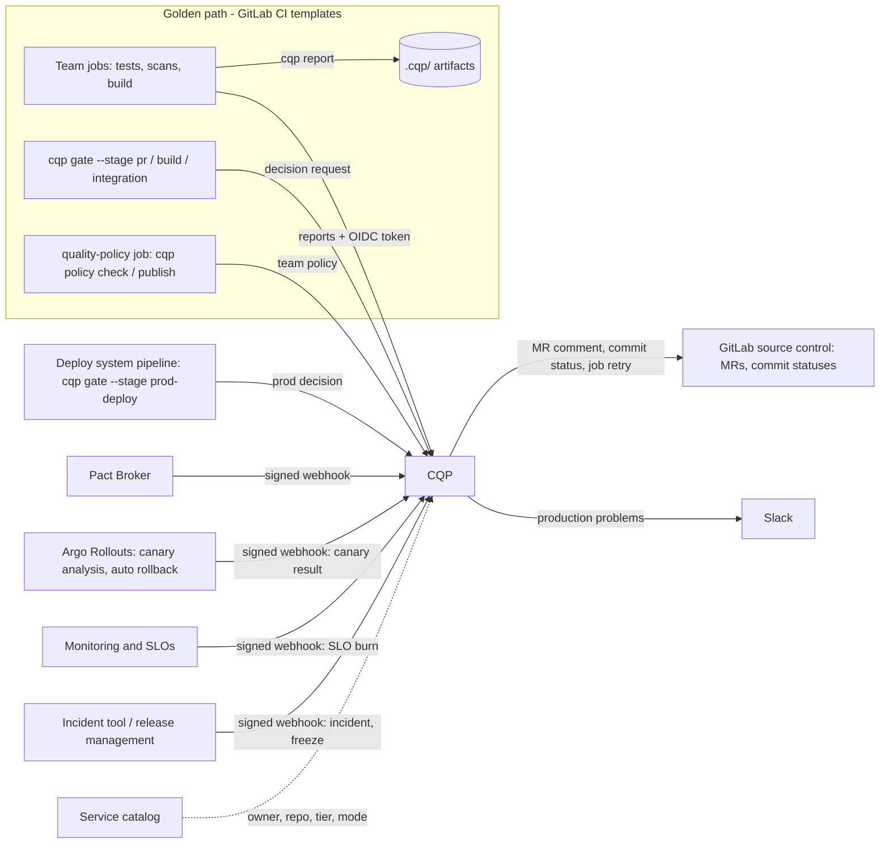
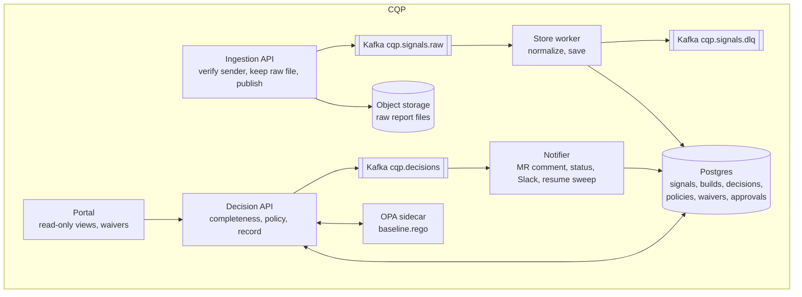
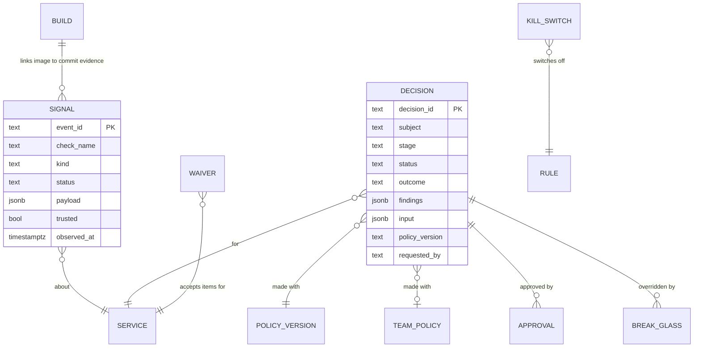
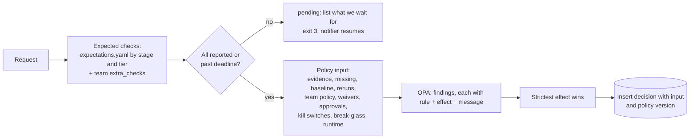
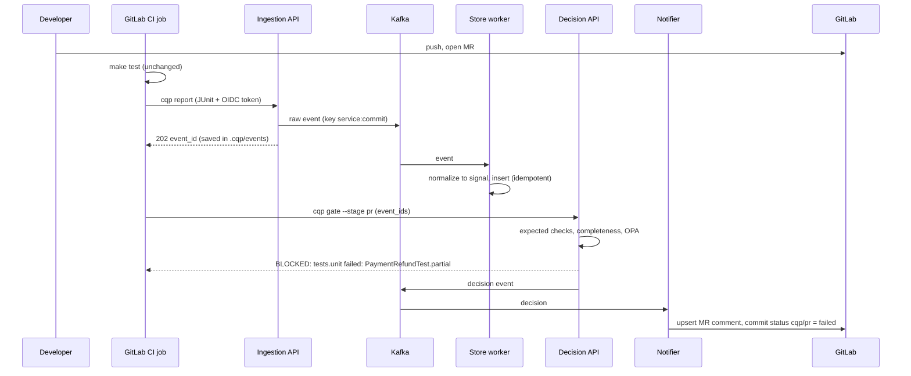
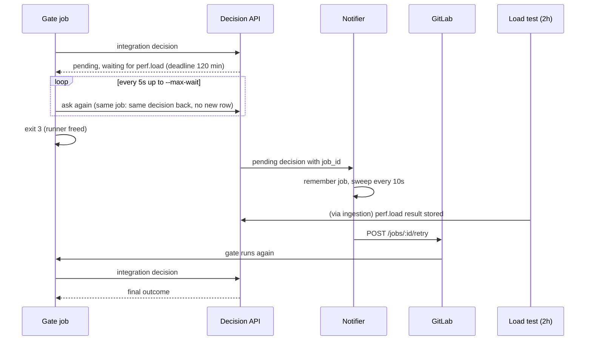
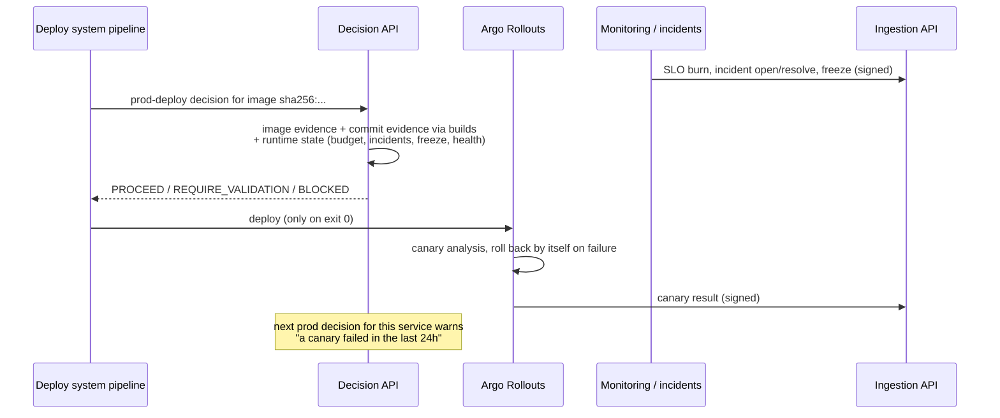

# Continuous Quality Platform: design

This document answers one question for every change: **do we have enough confidence to let this
change move to the next stage, and up to production?** It describes the architecture of the
Continuous Quality Platform (CQP), why it is shaped this way, and what we chose not to do.

The repository has a working prototype of most of it. Where something is design-only (the
production path), the text says so. Section numbers follow the brief's deliverable list.

| # | Section | Brief area |
| --- | --- | --- |
| 1 | Problem interpretation and assumptions | Background, constraints |
| 2 | Architecture and diagrams | 1. Architecture |
| 3 | Components and responsibilities | 1. Architecture |
| 4 | Quality signals, evaluation and policy | 2. Signal model, 3. Decisions |
| 5 | Important system flows | 5. Production quality |
| 6 | Scale, reliability and operations | Bonus 1 and 3 |
| 7 | Developer experience and adoption | 4. Developer experience, 7. Adoption |
| 8 | Trade-offs, alternatives, build vs buy | Bonus 2 |
| A | Appendices: code map, risks, resources | |

---

## 1. Problem interpretation and assumptions

### 1.1 What the problem really is

The organisation doesn't lack quality signals. It lacks a **shared way to turn them into a
decision**, and a way to **explain** that decision. Today each team's pipeline answers the
question differently, so the answers can't be compared, audited or improved centrally.

That breaks down into five concrete problems:

1. **Different shapes.** "96% passed", "CVE-2026-1234 critical" and "p95 +20%" are different kinds
   of fact. They need one model before any rule can combine them.
2. **Different timing.** Unit tests report in seconds; a load test takes two hours; production
   health keeps changing after the deploy. A decision has to know what it is still waiting for.
3. **Low trust in the signals.** Flaky tests and blind reruns teach people to ignore red. The
   platform must make flakiness visible instead of rewarding the rerun.
4. **Inconsistent gates with real ownership.** Central teams want a floor; product teams want
   control. The answer is a locked organisation baseline that teams can only tighten, plus
   bounded, reviewed, expiring exceptions.
5. **The platform must not be the bottleneck.** It sits on every pipeline. It has to be cheap to
   call, safe when it is down, and never in the rollback path.

### 1.2 What CQP is, and what it isn't

CQP **is** a decision service with an evidence store, plus thin golden-path steps that feed it
and ask it questions. CQP **is not** a test runner, a scanner, a CI system, a deploy system or a
monitoring system. It reads what those systems already produce and leaves the doing to them.

### 1.3 Assumptions

| Area | Assumption |
| --- | --- |
| CI | GitLab CI is the golden path. Each job can get a short-lived OIDC `id_token` (audience `cqp`) with `project_path`, `sha`, `job_id`, `pipeline_id`, `ref_protected`. GitHub Actions works the same way with `id-token: write`. |
| Golden path | Shared CI templates (`include:`) are already widely used. Adding a step to a template reaches most services without each team editing its pipeline. |
| Service catalog | A catalog (Backstage or similar) knows each service's owner, repo and tier. The prototype stands in with `policy/catalog.yaml`. |
| Deployments | One central deploy system deploys images to production through progressive delivery (Argo Rollouts or similar) that runs canary analysis and rolls back by itself. |
| Observability | SLO and error-budget data is Prometheus-compatible. An incident tool can send webhooks. Release management can announce change freezes. |
| Report formats | Most tools can emit JUnit, SARIF, CycloneDX or a JSON summary. The few that can't get a small adapter. |
| Ownership | One central quality/platform group owns the organisation baseline. Security owns the security rules within it. Teams own their team policy file. |
| Identity | People's roles (approver, security, on-call, platform) come from a group lookup. The prototype stands in with a `cqp_role` claim. |
| Scale | About 600 engineers, 50 teams, 500 services, 500 pipelines/day, 30–50 production deploys/day, doubling within two years. |

---

## 2. Architecture

### 2.1 Context: where CQP sits

CQP plugs into the golden path at three extension points: a **report step** after jobs that
produce results, a **gate step** at each stage boundary, and a **policy step** when a team edits
its policy file. Tools outside CI talk to it through signed webhooks.



How CQP relates to each system the brief names:

| System | How CQP uses it | What CQP never does |
| --- | --- | --- |
| Golden path | Adds three steps to the shared templates. Uses CI artifacts to pass `.cqp/` state between jobs. | Replace templates or own pipelines |
| Source control | Posts one MR comment (updated in place) and one commit status per stage. Team policy lives in the repo (`.quality/policy.yaml`) and is reviewed like code. | Gate merges by itself; merge rules stay in GitLab (required status checks) |
| CI/CD | Each job's OIDC token proves who is reporting. The notifier retries a waiting gate job through GitLab's API. | Drive pipelines, run jobs, hold runners for hours |
| Test frameworks | Reads their standard output files (JUnit, k6 JSON). | Change how teams write or run tests |
| Security tooling | Reads SARIF and CycloneDX from scanners; failing items are CVE IDs or fingerprints, so a waiver can name them. | Scan anything itself |
| Static analysis | Reads SARIF. Error-level results fail; counts by level are kept. | Replace the analyser's own thresholds UI |
| Deployment systems | The deploy system asks for the `prod-deploy` decision about an image. Canary results come back by webhook. | Deploy, or sit in the rollback path |
| Observability | Receives SLO burn, incidents and freezes as signals. These shape the next production decision. | Own alerting for services |

### 2.2 Components



CQP is **four deployables** from one repository and one image: Ingestion API, store worker,
Decision API and notifier. They are split because their load and failure behaviour differ:

- If the **notifier** is down, decisions still work; comments lag.
- If **Kafka** is down, the Decision API still answers from what is stored; new evidence waits
  in CI artifacts and the `cqp report` retries.
- The **Decision API** is the only thing on the pipeline's critical path, so it has the tightest
  SLO and the fewest dependencies (Postgres and a local OPA sidecar).

They live in one repository because the code they share (event shape, signal model, policy input)
is the contract between them, and changing it in one commit is safer than versioning it across
repositories.

---

## 3. Components and responsibilities

| Component | Responsibility | Key properties |
| --- | --- | --- |
| **`cqp` CLI** (golden-path steps) | `report`: upload a job's files, never fail the job. `gate`: ask for a decision, poll while pending, turn the answer into an exit code. `policy`, `waiver`, `approve`, `kill-switch`, `break-glass`, `preview`, `explain`, `baseline backtest`. | Report retries 2s/4s/8s then gives up quietly. Gate fails loudly when CQP *refuses* (bad token, wrong repo) and uses the fallback only when CQP is *unreachable*. |
| **Ingestion API** | One front door for evidence: `POST /v1/reports` (CI) and `POST /v1/hooks/{tool}` (signed webhooks). Verifies the sender, checks service ownership, stores raw files, publishes a small event. | Identity (repo, commit, job) comes from the verified token, never from the body. Event ID is a hash, so the same upload twice is one event. |
| **Store worker** | Reads raw events, normalizes each into one signal, writes Postgres. Unreadable events go to the DLQ. | Offset committed only after the database write. DLQ'd evidence counts as *missing*, never as a pass. |
| **Decision API** | Works out what this stage expects, whether it has arrived, what the rules say, and records the decision with its full input. | Insert-only decisions. Same transaction reads evidence and writes the decision. Never decides on half the evidence. |
| **OPA sidecar + `baseline.rego`** | The organisation's rules: effects per check and stage, locked cells, waiver/approval/quarantine rules, production-state rules. | Pinned version hash on every decision. If OPA loses the rules, CQP reloads them; "no answer" is never read as "no findings". |
| **Notifier** | MR comment, commit status, Slack for production problems, waiver reminders, and re-running gate jobs that were pending. | Idempotent comment upsert by hidden marker. Offset committed after side effects. |
| **Portal** | Read-only views: active waivers (create or revoke them there), rules switched off, break-glass and approvals in the last week, flake candidates, each service's tier, owner and team policy version, recent decision outcomes. | Behind SSO in production. Shows outcomes, not the evidence behind them. |

---

## 4. Quality signals, evaluation and policy

### 4.1 The signal model

Every result, whatever tool produced it, becomes one **signal**:

| Field | Meaning |
| --- | --- |
| `event_id` | Hash of producer, check, service, commit, run and file contents. Duplicates collapse. |
| `service`, `commit`, `image` | What the result is about. Tests are about a commit; scans are about an image; runtime signals are about a service. |
| `check` | A fixed vocabulary: `tests.unit`, `tests.contract`, `scan.sca`, `perf.load`, `deploy.canary`, `runtime.slo`, … New kinds start in one list. |
| `kind` | `outcome` (pass/fail with names), `findings` (items with severity and fingerprints), `measurement` (a value and unit), `health` (production state). |
| `status` | `pass` or `fail`, as the parser judges it. Measurements are always `pass`; judging them is policy's job. |
| `payload` | Small and kind-specific: counts, failing test names, CVE IDs, fingerprints, p95 value. |
| `run`, `producer` | Which job or tool run produced it. Newest run per check wins. |
| `observed_at` | When the result was produced (token `iat` for CI, optional field for webhooks), so late or out-of-order arrivals don't overwrite newer results. |
| `trusted` | True if it came from a protected ref (`ref_protected` in the token) or a signed webhook. |
| `raw_ref` | Where the original file is kept. The signal can always be rebuilt from it. |

Two more records tie signals together: **builds** (which image came from which commit, recorded
only from trusted provenance) and **baseline** (the last result of each check from a protected
branch on a different commit, used to tell "new" from "already there").



**Why counts, not percentages.** "96% passed" is stored as `total`, `failed` and the failing test
names. A percentage hides *which* tests failed, so a later rule couldn't tell a flaky e2e test
from a broken unit test, and a waiver couldn't name what it accepts.

### 4.2 The brief's example signals

| Signal in the brief | Stored as | How policy reads it |
| --- | --- | --- |
| 96% tests passed | `tests.unit` · outcome · fail · `{total: 250, failed: 10, failing: [...]}` | Fails with the stage's effect (block at PR for unit tests). Quarantined tests only warn. A pass on rerun after a failure adds `baseline.passed_on_rerun`. |
| Contract validation failed | `tests.contract` · outcome · fail, from the Pact Broker webhook | Block at build, integration and prod-deploy (locked: teams can't loosen it). |
| Critical vulnerability | `scan.sca` · findings · fail · `{by_severity, failing: [CVE-...]}` | Block at build. If every failing CVE is already failing on the protected branch, it only warns at PR/build/integration. Item-scoped waivers with a security approver. |
| P95 latency +20% | `perf.load` · measurement · `{value: 180, unit: ms}`, compared to the protected-branch baseline | `baseline.perf.regression` warns over +20%; a team may set `max_increase_pct` and `max` with its own effect. |
| Deployment error rate increased | `deploy.canary` · health · fail, from Argo Rollouts after its analysis | The rollout controller already rolled back. CQP records it; the next prod decision for that service warns (`baseline.recent_rollback`). |
| End-to-end test failed | `tests.e2e` · outcome · fail | Warn at PR, validate at integration (teams commonly tighten). Flake candidates surface for quarantine. |
| Static-analysis threshold exceeded | `static.quality` · findings · fail when any error-level SARIF result exists | Warn at PR, block at build. New-vs-existing applies, using SARIF fingerprints. Not locked: a team may soften it. |

### 4.3 How a decision is made

A decision request names the service, stage and (from the build onwards) the image. The commit
comes from the token.



1. **Expected evidence.** `expectations.yaml` lists which checks each stage expects, per tier,
   with a `deadline` (minutes) and an `on_missing` effect. A team can add checks, never remove
   baseline ones.
2. **Completeness.** A check that hasn't reported is *waiting* until its deadline (counted from the
   first time this change was asked about at this stage), then *missing*. Results past their
   `max_age_days` (scans: 7 days) count as missing and say "too old". The caller's own uploads
   still in Kafka are waited for, for up to 60 seconds counted from **that gate job's** first
   request, so a retried job gets its own minute.
3. **Never decide on half the evidence.** While anything is waiting, the answer is `pending` with
   the list of what it is waiting for.
4. **Rules.** OPA turns evidence into findings. Failing checks get the effect from the stage
   matrix (or the team's stricter one). Missing checks get `on_missing`. Production state adds
   its own findings at `prod-deploy`.
5. **Adjustments, in a fixed order:** a kill switch (the rule only warns); otherwise a waiver
   (covered items only warn), then quarantine (quarantined tests only warn), then an approval
   (approved `validate` findings only warn); break-glass last (everything only warns, plus a
   `baseline.break_glass` finding). Findings are never hidden; each says why it was softened.
6. **Outcome.** The strictest effect wins: none → `PROCEED`, warn → `PROCEED_WITH_WARNING`,
   validate → `REQUIRE_VALIDATION`, block → `BLOCKED`.
7. **Record.** The decision, its findings, the **exact policy input** and the policy version hash
   are inserted, never updated. `replay()` re-runs any old decision on the Rego it was made with.

The four outcomes map to the gate's exit codes:

| Outcome | Meaning | `cqp gate` exit |
| --- | --- | --- |
| `PROCEED` | All expected evidence in, nothing objected | 0 |
| `PROCEED_WITH_WARNING` | Fine, but something should be looked at | 0 |
| `REQUIRE_VALIDATION` (final) | A person must approve | 2 |
| pending | Still waiting for evidence; the notifier re-runs this job | 3 |
| `BLOCKED` | Must not move on | 1 |

### 4.4 New vs existing, and baselines

Blocking a change on problems it didn't introduce is the fastest way to lose teams. The policy
input carries `baseline`: the last result of each check from a protected branch, on a different
commit.

- For `scan.sca`, `scan.container` and `static.quality` at PR, build and integration, a failure
  whose failing items are all already failing on the protected branch only warns: "all 3 failing
  already on the protected branch, not introduced by this change". Any new item keeps the normal
  effect, and the message names it: "new in this change: CVE-2 (1 more already on the protected
  branch)".
- `scan.secrets` is never relaxed: a leaked secret is a problem wherever it came from.
- At `prod-deploy` everything is judged: the image is what it is. Legacy debt there is handled by
  item-scoped waivers, which the shadow phase (section 7.4) surfaces before enforcement starts.
- Measurements use the same baseline. `baseline.perf.regression` warns when p95 is over 20% above
  the protected-branch value. Teams can set `max_increase_pct` (rule `team.perf.load.regression`)
  and an absolute `max` (rule `team.perf.load.threshold`), each with its own effect.

### 4.5 Flaky tests and reruns

A rerun that turns red into green is information, not a clean pass.

- **Visible reruns.** If the newest run of a check passed but an earlier run on the same change
  failed, the decision gets a `baseline.passed_on_rerun` warning naming the tests that failed
  before. A blind rerun shows up in the MR comment.
- **Flake candidates.** `GET /v1/flaky?service=&days=14` lists tests that failed and then passed
  on the same commit, with counts. The portal shows them per service.
- **Explicit quarantine.** A team quarantines in `.quality/policy.yaml`:

  ```yaml
  quarantine:
    tests.e2e: {ticket: QA-12, tests: [CheckoutFlow.applesPay]}
  ```

  A failing check whose failing tests are all quarantined only warns: "(quarantined under QA-12)".
  `baseline.rego` bounds it: only `tests.unit`, `tests.component`, `tests.api`,
  `tests.integration` and `tests.e2e` (never contracts or scans), at most 10 tests per check, and a
  ticket. It goes through the policy MR, so the backtest shows its effect before it merges.

CQP detects candidates but never quarantines automatically. Auto-quarantine silently turns real
regressions into warnings, and someone has to own the fix.

### 4.6 Policies: created, configured, versioned, evaluated

| Layer | Where | Who changes it | How it is versioned | Safety net |
| --- | --- | --- | --- | --- |
| **Organisation baseline** | `policy/baseline.rego`, `expectations.yaml` in the CQP repo | Platform/quality group; security for security rules (CODEOWNERS) | Hash of Rego + expectations, recorded on every decision; each version's Rego kept in `policy_versions` | `cqp baseline backtest` on MRs touching `baseline.rego`; `TooManyBlocks` alert; kill switch |
| **Team policy** | `.quality/policy.yaml` in the service repo | The owning team, through an MR | Content hash; every version kept; each decision records `team_policy_version` | `cqp policy check` validates bounds and backtests on the last 40 decisions; publish only from a protected branch of the owning repo |
| **Waiver** | Portal or `cqp waiver` | Approvers of the owning service; security for security rules | Insert-only, expires (max 30 days), revocable | Must name items for scan rules; reminder 2 days before expiry |
| **Approval** | `cqp approve` | Approvers/security of the owning service, never the requester | Insert-only, 24 hours | Covers exactly the `validate` findings it saw |
| **Kill switch** | `cqp kill-switch` | Platform team | Insert-only, max 72 hours | Alert after 4 hours |
| **Break-glass** | `cqp break-glass` | On-call, approvers, security | Insert-only, one change, one stage, 24 hours | Slack 🚨 and ticket alert every time |

**Bounds.** The baseline has *locked cells* (for example `scan.sca` at build, `tests.contract` at
integration). A team may make a locked cell stricter, never looser; anything else in the matrix
it can tune. Unknown keys in the team file are rejected, so a typo can't silently do nothing.

**Approvals** (`cqp approve --decision <id> --reason ... [--ticket ...]`) apply only to a final
`REQUIRE_VALIDATION` decision: a block never becomes approvable, and pending is waiting for
evidence, not a person. The approval covers exactly the `validate` findings (rule and message) of
that decision, so a worse load test on the next run needs a new look. Re-running the gate job
picks it up.

**Baseline backtest** (`cqp baseline backtest`) runs a candidate `baseline.rego` on the last 200
final decisions across all services and lists the outcomes it would change. The CQP repo's CI
runs it on every MR that touches `policy/baseline.rego`. Expectation changes aren't backtested:
they change what we wait for, not how evidence is judged.

---

## 5. Important system flows

### 5.1 MR to PR gate



The MR comment lists each finding with its rule and effect, what CQP is still waiting for, and
the decision and policy version. After a fix, the next pipeline updates the same comment.

### 5.2 Long-running check: pending, then resume



If the check never arrives, the sweep retries the job at the deadline and the check counts as
missing with its `on_missing` effect.

### 5.3 Production deploy with runtime state



Only the deploy system (a project in `policy/trust.yaml`, from a protected branch) may ask for a
`prod-deploy` decision, so a service's pipeline can't deploy around its own gates. Production
state shapes the next deploy:

| Production state | Effect |
| --- | --- |
| Error budget used up | validate, unless released as a fix (`cqp gate --fix <ticket>`, which warns) |
| Active incident on the service | validate, unless released as a fix |
| Canary failed in the last 24 hours | warn: use the slowest canary steps |
| Organisation-wide freeze | block (emergencies use break-glass) |
| Health missing or older than 5 minutes | validate for tier-1, warn otherwise |

**Evidence integrity for production.** At `prod-deploy`, image-bound evidence from untrusted
(unprotected) refs can only make things stricter: an untrusted pass is ignored, an untrusted fail
counts. The image→commit link is recorded only from trusted provenance, so a branch job can't
claim an image was built from a clean commit. The production path replaces the self-reported
digest with signed SLSA provenance verified at ingestion (Sigstore/cosign attestations).

**Design-only:** linking incidents back to the decision that let the change through, a nightly
re-scan of running images feeding new CVEs into the next decision, and pulling health from the
monitoring API on demand when the last push is stale.

---

## 6. Scale, reliability and operations

### 6.1 Back-of-envelope

| Quantity | Today | In two years (×2) |
| --- | --- | --- |
| Pipelines/day | 500 | 1,000 |
| Evidence events/day (≈10 reports per pipeline + webhooks) | ~5,000 | ~10,000 |
| Average evidence rate | 0.06/s | 0.12/s |
| Peak evidence rate (working hours, 10–20×) | ~1/s | ~2.5/s |
| Decision requests/day (≈4 gates per pipeline, plus polls) | ~3,000 rows, ~20k requests | ~6,000 rows, ~40k requests |
| Peak decision requests (200 gates polling every 5s) | ~40/s | ~80/s |
| Decision rows × input size (~10 KB) | ~30 MB/day | ~60 MB/day ≈ 22 GB/year |
| Raw report files (~500 KB each) | ~2.5 GB/day | ~5 GB/day ≈ 1.8 TB/year |

**Conclusion: throughput is not the problem.** A single Postgres primary and a three-broker
Kafka cluster have orders of magnitude of headroom. The real risks are:

1. **Decision-path availability and latency.** Every pipeline calls it. A slow or failing gate
   stalls 600 engineers.
2. **Notification correctness.** A missing resume leaves a pipeline stuck; a duplicate comment
   erodes trust.
3. **Human attention.** False blocks, flaky tests and noisy warnings cost far more than CPU.

So the design spends its effort on idempotency, clear failure modes and explainability, not on
sharding.

**Storage plan.** Partition `decisions` and `signals` by month. Keep decisions 2 years online
(audit), older ones in cold storage. Keep `prod-deploy` decisions and the evidence they reference
for as long as audit requires. Raw files go to S3 with a lifecycle rule: infrequent-access after
30 days, deleted after 400 days unless a production decision references them.

### 6.2 Why Kafka, and when not to use it

At this volume Kafka is not needed for throughput. It is there for:

- **Decoupling:** the Ingestion API acknowledges once the event is durable, whatever the store
  worker or Postgres is doing.
- **Replay:** a parser fix can re-read events (and the DLQ) and rebuild signals.
- **Burst absorption:** webhook storms (an incident tool resending, a scanner re-scanning
  everything) don't hit Postgres directly.

The alternative is a **Postgres transactional outbox** (write the raw event and an outbox row in
one transaction, a relay publishes or processes it). That is simpler to operate and would be the
right choice if the organisation doesn't already run Kafka. If it does, managed Kafka costs
little extra. The code keeps publishing behind one `publish()` function, so swapping is local.

### 6.3 Consistency

| Data | Consistency | Why |
| --- | --- | --- |
| Decision + the evidence it read | **Strong**: one transaction | The recorded input must be exactly what the outcome was computed from, or replay and audit are meaningless |
| Waivers, approvals, kill switches, break-glass | **Strong**: written to Postgres before the API returns | An approval or revoke must apply to the very next decision |
| Team policy publish | **Strong** | The backtest result shown must match what goes live |
| Evidence arrival (upload → signal) | **Eventual** (SLO: 99% under 60s) | The completeness check and in-flight grace cover the gap; nothing is decided on half the evidence |
| MR comments, commit statuses, Slack | **Eventual** | Informational; the gate's exit code is the authority |
| Runtime state (SLO, incidents) | **Eventual**, with freshness checks | Stale health is itself a finding |
| Metrics and dashboards | **Eventual** | |

### 6.4 Failure modes

| Failure | Behaviour |
| --- | --- |
| **Duplicate result** | Same `event_id`, insert does nothing |
| **Out-of-order or late result** | Newest by `observed_at` wins, not by arrival; an older run arriving late can't replace a newer one |
| **Unreadable report** | Parked in the DLQ, counts as missing (never a pass), alert `DeadLetterGrowing` |
| **Kafka down** | `cqp report` retries then gives up without failing the job; files stay in CI artifacts for backfill. Decisions still answer from stored evidence; decision events may lag |
| **Store worker crash** | Restarts from the last committed offset; idempotent inserts make re-reads safe |
| **OPA lost its rules** | Decision API reloads and asks again; "no result" is an error, never "no findings" |
| **Decision API or Postgres down** | Gate fallback (below) |
| **External tool down** (Pact Broker, scanner, monitoring) | Its check doesn't arrive; after the deadline it is missing with its `on_missing` effect. Stale health is a finding |
| **Long-running check** | Pending with a deadline; runner freed (exit 3); notifier re-runs the job |
| **Notifier down** | Decisions still enforced by exit codes; comments and resumes catch up from Kafka |
| **GitLab API 5xx** | Notifier crashes on purpose and re-handles the message; comment and status writes are idempotent |
| **Bad baseline release** | Caught by backtest before merge; if not, `TooManyBlocks` pages and the kill switch turns one rule into a warning everywhere |

**Gate fallback when CQP is unreachable.** `cqp report` also records each report's pass/fail
locally in `.cqp/results/`. If CQP can't be reached, the gate **blocks** when this pipeline's own
`tests.unit`, `tests.component`, `tests.integration` or `scan.secrets` failed: the checks the
baseline blocks at every stage that judges them (a test keeps the gate's list equal to the
Rego's). Otherwise it continues with a warning before production, and needs
approval at `prod-deploy`. The trade-off: fail-open on unknowns keeps 50 teams delivering through
a CQP outage; fail-closed on known-bad means an outage never lets a red unit test or a leaked
secret through.

### 6.5 Operations

**SLOs** (prototype metrics and alert rules exist for each):

| SLO | Target | Metric |
| --- | --- | --- |
| Decision API availability | 99.9% of requests succeed | `cqp_decision_errors_total` |
| Decision latency | p99 under 1s | `cqp_decision_seconds` |
| Evidence freshness | 99% of uploads stored within 60s | `cqp_evidence_delay_seconds` |
| Resume | a waiting gate is retried within 30s of its evidence arriving | `cqp_waiting_gate_jobs`, `cqp_gate_retries_total` |

**Alerting.** "Page" means delivery is affected now (`CQPServiceDown`, `DecisionAPIErrors`,
`DecisionLatencyHigh`, `EvidenceDelayed`, `TooManyBlocks`). "Ticket" means fix it soon
(`DeadLetterGrowing`, `NotifierFailing`, `GateJobsPilingUp`, `BreakGlassUsed`,
`RuleSwitchedOffTooLong`). Rules are unit-tested with `promtool`. Each carries a one-line runbook.

**Availability.** The Decision API is stateless: three or more replicas across zones, each with
its own OPA sidecar. Postgres is a managed primary with a synchronous standby in another zone.
Kafka is three brokers, replication factor 3. The notifier and store worker scale by consumer
group partitions.

**Auditing.** Every decision stores who asked (`requested_by`), its exact input, the baseline
version and team policy version. Waivers, approvals, kill switches and break-glass are insert-only
with who, why, ticket and expiry. `replay()` proves any past outcome from its stored input. For
production audits: "show every prod deploy of payments-api last quarter, with the evidence and
any override" is one query.

**Failure investigation.** Each decision ID appears in the gate log, MR comment and Slack.
`cqp explain <id>` and `GET /v1/decisions/{id}` show the full input. Raw files are kept, so a
signal can be re-derived. Design-only: tracing across ingestion → store → decision.

**Disaster recovery.** Postgres: point-in-time recovery, RPO 5 minutes, RTO 1 hour. Signals can be
rebuilt from raw files in S3 (cross-region replicated) by replaying them through the store worker.
Decisions can't be rebuilt, so they rely on database backups. During a regional outage, the gate
fallback keeps delivery going.

**Capacity planning.** Review quarterly: decision p99 and request rate against the poll
multiplier (pending gates × 1 per 5s), Postgres size growth against partitions, Kafka consumer
lag. The first lever at 2× is raising the poll interval or `--max-wait`, not adding hardware.

---

## 7. Developer experience and adoption

### 7.1 Onboarding a service through the golden path

1. The service is in the catalog (owner, repo, tier). New services get `mode: shadow`.
2. The team's jobs extend the golden-path templates, which they already use. A test job adds
   three variables:

   ```yaml
   unit-tests:
     extends: .quality-report
     variables: {CQP_CHECK: tests.unit, CQP_FORMAT: junit, CQP_FILES: "reports/**/*.xml"}
     script: [make test]   # unchanged
   ```

3. The default pipeline template already includes `.quality-gate` jobs at each stage.

No test code changes. No new tool. The first decisions appear in the portal the same day.

### 7.2 Day to day

| Moment | What the engineer sees |
| --- | --- |
| **Local development** | `cqp preview --stage pr --report tests.unit:junit:'reports/**/*.xml'` parses local reports with the same parsers and asks `POST /v1/preview` (no token, nothing recorded) for the outcome under the real baseline, team policy and waivers. It lists expected checks not run locally. |
| **Pull request** | One MR comment, updated in place: outcome, each finding with its rule, what it is waiting for, decision ID. One commit status per stage. |
| **CI pipeline** | The gate job log prints the same findings. Exit codes are fixed: 0, 1, 2, 3. |
| **Investigating a failure** | `cqp explain <decision-id>` prints each finding and what you can do next: fix, rerun, ask for a waiver, ask for an approval, or quarantine a flaky test. Failing test names, CVE IDs and fingerprints are in the finding. A pass after a rerun is flagged. |
| **Why was I blocked?** | The finding names the rule and the evidence; the decision records the policy version; replay reproduces it. No score to interpret. |
| **Waiting for a slow check** | The job exits 3: "waiting for perf.load … CQP re-runs this job when it arrives or at its deadline". The MR comment says the same. The notifier retries it. |
| **Needs validation** | Exit 2 and the comment shows the `validate` findings. A different approver runs `cqp approve`; re-run the gate. |
| **Changing team policy** | Edit `.quality/policy.yaml` in an MR. The `quality-policy` job validates it and prints "2 of the last 40 decisions would change: integration PROCEED → BLOCKED". Merge publishes it. |
| **Emergency** | `cqp break-glass` for one change and one stage, with a ticket. Every finding still shows; Slack announces it. |

Reading a decision record (`GET /v1/decisions/{id}`) needs a valid token, because it carries the
full evidence, including unfixed CVE IDs. The portal stays read-only and sits behind SSO in
production.

### 7.3 Confidence, not just gates

- **Not blamed for old problems:** existing findings only warn on a change.
- **Flakiness made visible:** passed-on-rerun warnings, flake candidates, bounded quarantine.
- **Slow checks don't hold the developer:** pending frees the runner; resume is automatic.
- **Bounded, visible exceptions** rather than teams disabling a gate in their YAML.
- **The same answer everywhere:** CI, MR, portal and local preview evaluate the same rules.

### 7.4 Incremental adoption

Each service has a `mode`. The outcome is computed the same way in every mode; only what the gate
does with it differs.

| Mode | Gate | Visible to the team | Exit criteria to move up |
| --- | --- | --- | --- |
| `shadow` | exits 0 at once | nothing; platform watches the decisions table | 2 weeks of data; decision p99 < 1s; would-have-blocked rate understood and legacy findings waived or fixed |
| `advisory` | exits 0, log says "would be BLOCKED" | MR comment marked advisory; status stays green | Would-have-blocked rate < 5% of pipelines, false-block rate (blocks the team disputes) < 1%, flake rate on gated checks < 2% |
| `enforce` | acts on the outcome | everything | Monitored: rollback to advisory is a one-line catalog change |

**Organisation rollout:**

1. **Weeks 1–4:** two or three pilot teams who asked for it, in advisory. Fix the noisy rules.
2. **Weeks 5–10:** every service in shadow (one template change). Measure, publish per-team
   would-have-blocked reports, help teams clear legacy CVEs with waivers.
3. **Weeks 11–20:** tier-2/default services move to advisory then enforce, in waves of five to ten
   teams, each with an owner and office hours.
4. **After that:** tier-1 services last, once the platform has met its SLOs for a quarter. They
   carry the strictest `prod-deploy` rules, so they need the most trust in CQP itself.

Teams that already have strict gates keep them; CQP runs beside them in advisory until they
choose to retire their own.

---

## 8. Trade-offs, alternatives and build vs buy

### 8.1 Alternatives considered

| Choice | Alternative | Why we chose this |
| --- | --- | --- |
| **Strictest finding wins** | A numeric quality score (weighted sum) | A score can't be explained ("why 71?"), invites gaming, and lets many small passes outweigh one critical CVE. Findings with rules and messages are auditable and actionable. |
| **Central decision service** | A library embedded in the golden-path step that evaluates locally | A library can't see evidence from other jobs, webhooks or production; can't enforce waivers or approvals consistently; and every policy change needs every pipeline to update. The CLI stays thin. |
| **Pull: pipelines ask; notifier only retries** | Push: CQP drives pipelines (triggers stages) | Pipelines stay owned by GitLab and teams. CQP never needs pipeline-write power beyond "retry this gate job", and an outage can't strand pipelines in a half-driven state. |
| **OPA/Rego** | CEL, or a custom YAML DSL | Rego handles sets, bounds checks and "every item covered" naturally, has a test tool and a sidecar model, and is widely known in platform teams. CEL is simpler but weaker for set logic. A custom DSL becomes a language we'd have to maintain. Teams write YAML; only the platform writes Rego. |
| **Kafka** | Postgres outbox, or direct writes | See 6.2: decoupling, replay and burst absorption. Outbox if the org doesn't run Kafka. |
| **Store full decision input** | Store only the outcome and findings | ~10 KB per decision is cheap. Without the input, "why was this blocked six months ago?" and policy backtests are impossible. |
| **Fail-open on unknown, fail-closed on known-bad** | Always fail-closed; always fail-open | Fail-closed makes CQP a single point of failure for 50 teams. Fully fail-open lets an outage hide a red unit test. Production always needs approval when CQP is down. |
| **Team policy in the repo** | A central policy UI | Policy changes get code review, history and a backtest in the MR, and the team owns them. A UI hides changes from the team and needs its own audit trail. Waivers are the exception: time-bound, so the portal is fine. |
| **Rollout controller owns rollback** | CQP decides rollbacks | A central service in the rollback path adds a failure point at the worst moment. CQP records the canary result and shapes the *next* decision. |
| **Pending exits 3 and the job is retried** | Hold the runner until evidence arrives; or a manual job the notifier "plays" | Holding runners for two-hour checks wastes capacity and hits job timeouts. A manual job needs a second job per gate in every template and shows as "blocked" in a way people click through. The cost of our choice: in GitLab the job shows red while waiting. The log, MR comment and `cqp/<stage>` pending status say it will re-run. |
| **Explicit quarantine** | Automatic quarantine of detected flakes | Auto-quarantine turns real regressions into warnings silently. CQP detects; a team decides, with a ticket, in review. |

### 8.2 Build, adopt, buy, delegate

| Capability | Decision | Reasoning |
| --- | --- | --- |
| Decision API, signal model, baseline, golden-path CLI, notifier | **Build** | This is the organisation-specific glue: our stages, tiers, trust model and exceptions. No product models "never decide on half the evidence" plus locked baselines with team tightening. It is small (a few thousand lines). |
| Policy engine | **Adopt OPA** | Mature, sidecar model, testable. |
| Event log, database, object storage | **Adopt Kafka/Postgres/S3; buy managed** (MSK/Confluent, RDS/Cloud SQL) | Commodity; managed services remove most of the operations work. |
| Progressive delivery | **Adopt Argo Rollouts** (or keep the existing equivalent) | Owns canary analysis and rollback. |
| Contract testing | **Adopt Pact Broker** | Already the standard; CQP only reads its webhooks. |
| Signing and provenance | **Adopt Sigstore/cosign, SLSA** | Production path for evidence integrity. |
| Vulnerability deduplication and lifecycle | **Adopt Dependency-Track or DefectDojo** | They track CVEs across images over time; CQP reads their results instead of reinventing triage. |
| Service catalog | **Adopt Backstage** (or the existing catalog) | `catalog.yaml` is a stand-in; ownership and tier must have one source. |
| Monitoring, dashboards, alerts | **Adopt Prometheus/Grafana/Alertmanager** | Already standard for SLOs. |
| Flaky-test and test analytics | **Consider buying** (Datadog CI Visibility, BuildPulse, Launchable/CloudBees) | Per-test history and flake scoring across thousands of tests is deep work. CQP's built-in rerun detection covers the gating need; a product can feed richer flake signals in later through a webhook adapter. |
| Running tests, scans, builds, deploys, rollbacks, service alerting | **Delegate** to existing systems | The brief's constraint: don't replace tools. CQP only reads their results. |

---

## Appendix A. Design to code

| Design component | Code |
| --- | --- |
| `cqp report`, local results | `src/cqp/gather/cli.py` |
| `cqp gate`, exit codes, fallback | `src/cqp/decide/gate.py` |
| `cqp policy`, `waiver`, `approve`, `kill-switch`, `break-glass`, `baseline backtest`, `preview`, `explain` | `src/cqp/decide/team_cli.py`, `src/cqp/gather/cli.py` |
| Ingestion API, trust | `src/cqp/gather/app.py`, `auth.py`, `adapters.py`, `event.py` |
| Signal model, parsers | `src/cqp/store/normalize.py` |
| Evidence store, latest/baseline/reruns | `src/cqp/store/db.py`, `worker.py` |
| Decision API, replay, backtests, preview | `src/cqp/decide/app.py` |
| Completeness, outcome | `src/cqp/decide/engine.py` |
| OPA client, policy versions | `src/cqp/decide/policy.py` |
| Decisions, policies, waivers, approvals, overrides | `src/cqp/decide/db.py` |
| Team policy shape | `src/cqp/decide/team.py` |
| Organisation baseline | `policy/baseline.rego`, `policy/expectations.yaml` |
| Catalog, adoption mode, deployers | `src/cqp/catalog.py`, `policy/catalog.yaml`, `policy/trust.yaml` |
| Notifier, resume sweep | `src/cqp/notify/worker.py`, `gitlab.py`, `db.py` |
| Portal | `src/cqp/decide/portal.py` |
| Golden-path templates | `ci/quality-report.gitlab-ci.yml` |
| Metrics and alerts | `src/cqp/metrics.py`, `ops/prometheus/` |

**Built in the prototype:** everything in sections 3–5 except the items marked design-only.
**Design-only:** S3 storage (local disk today), SSO and group lookup for roles, backfill from CI
artifacts, DLQ replay tooling, monthly partitions, Alertmanager routing, Grafana dashboards,
tracing, per-team Slack routing, signed provenance verification, incident-to-decision links,
nightly image re-scan, deploy-system approval-step integration, re-running the gate job
automatically after an approval or break-glass.

## Appendix B. Risks and open questions

| Risk or question | Mitigation or next step |
| --- | --- |
| A bad baseline release blocks many teams at once | Baseline backtest on MRs, `TooManyBlocks` page, kill switch |
| Teams treat warnings as noise | Keep warnings few and specific; track warn rate per rule; promote or delete rules that nobody acts on |
| Approvals become rubber stamps | Four eyes, 24-hour scope, exact findings only; report approval rate per team |
| Self-reported image digests | Protected-ref trust now; signed SLSA provenance next |
| Monorepos with many services in one repo | Catalog maps several services to one repo; `cqp report --service` per job; needs per-path ownership later |
| Merged-result pipelines change the commit SHA | Evidence is keyed by the commit the pipeline ran on; the merged commit gets its own pipeline on the default branch |
| Who owns flaky-test fixes | Quarantine requires a ticket and is capped at 10 tests per check; next: expiry for quarantine entries and their age on the portal |
| Single region | Fine for delivery (fallback keeps pipelines moving); revisit if production deploys need cross-region independence |

## Appendix C. Resources and tools

OPA, Argo Rollouts, Pact, CycloneDX, SARIF and GitLab OIDC documentation shaped the integration
choices. Google's SRE material on error budgets shaped the production rules. Claude Code was used
to help build the prototype and draft these documents; the design decisions and their review are
the author's.
